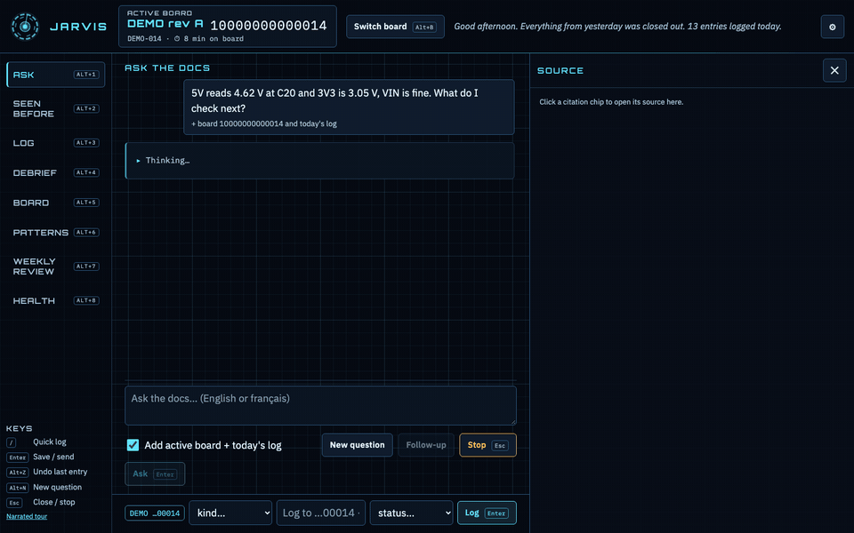
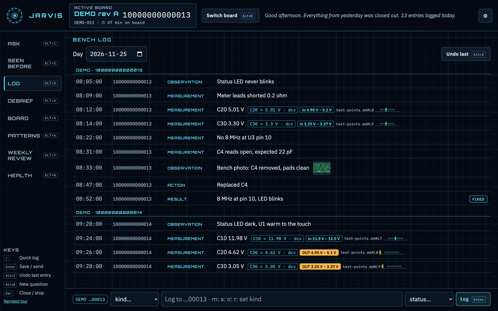
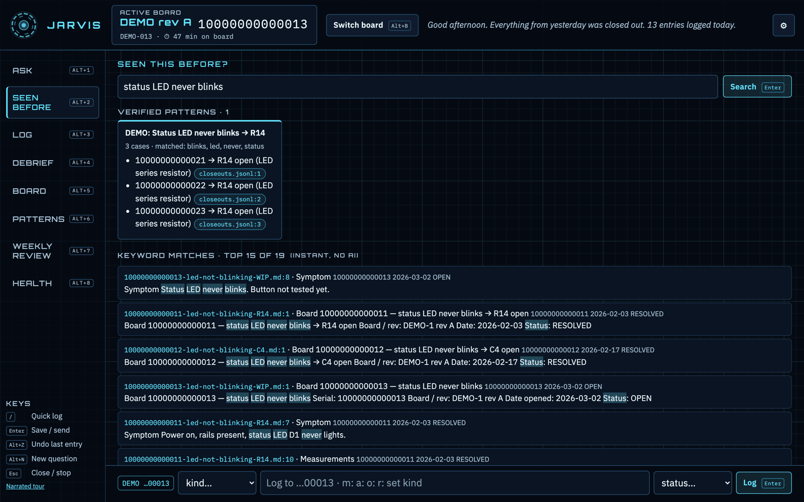
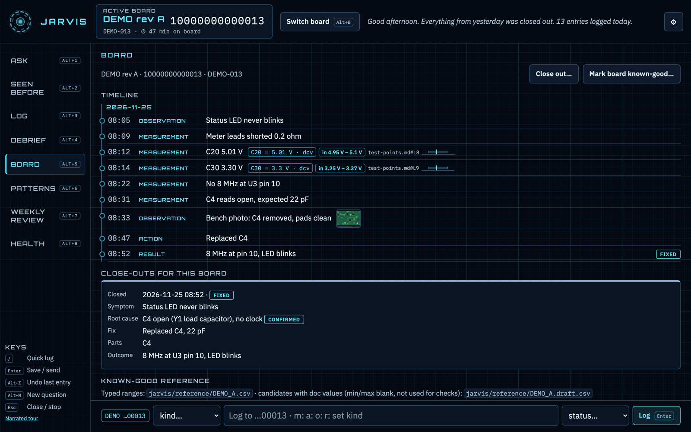
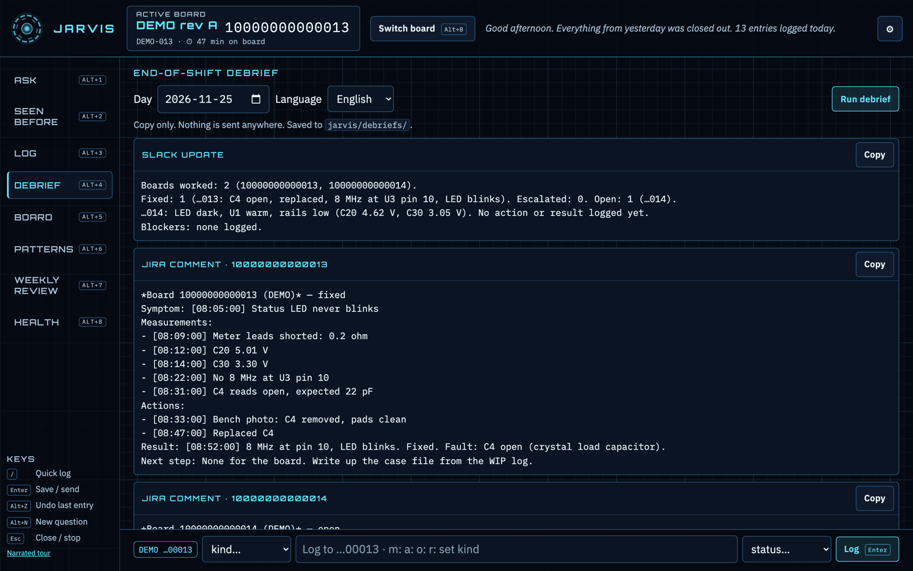
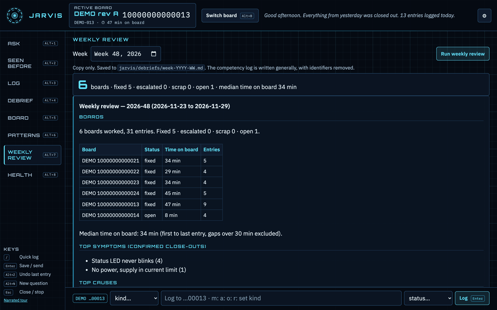
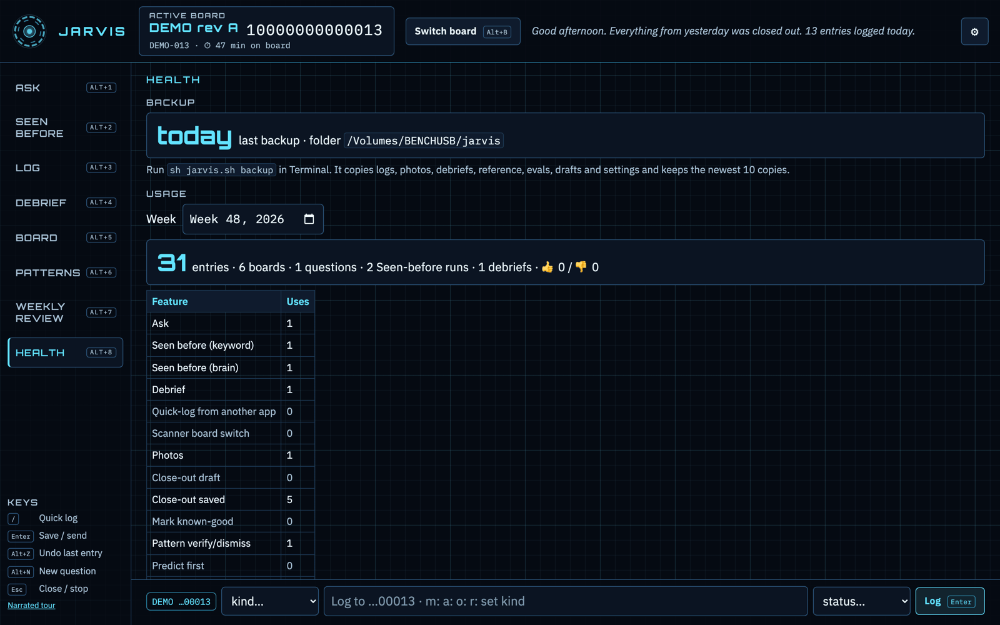
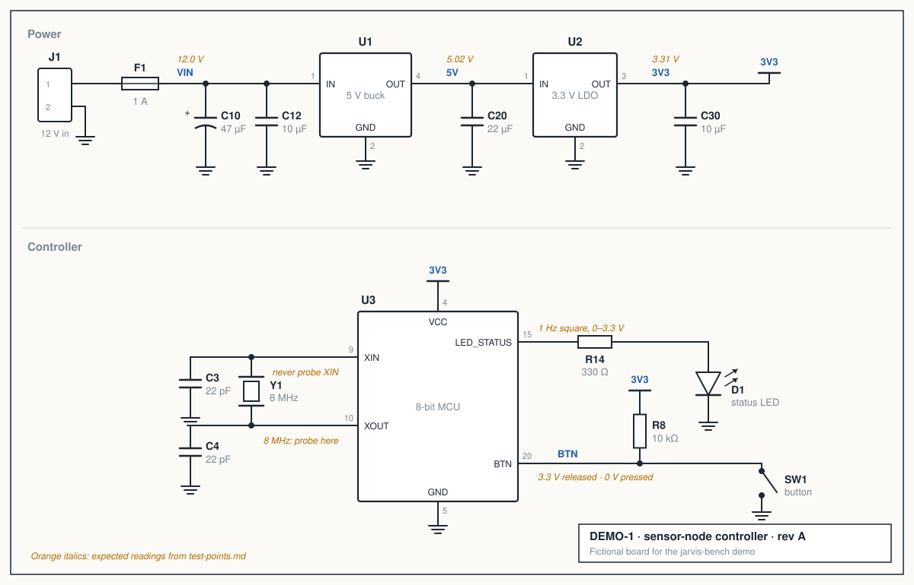
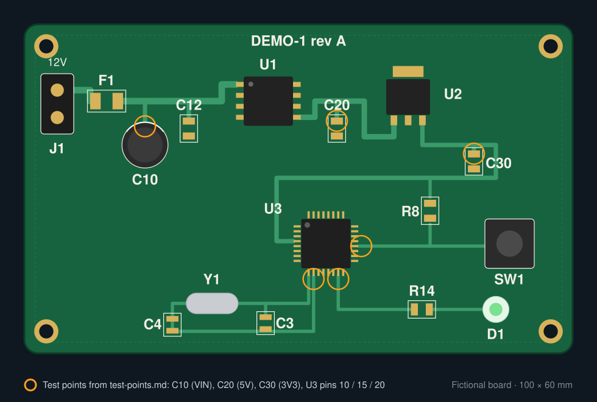
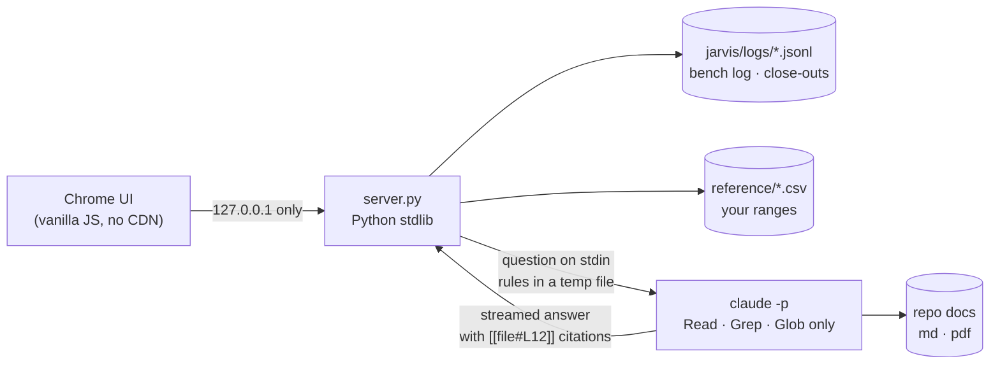

# jarvis-bench

**A local AI bench assistant for board-level electronics repair.** It answers from *your* repair docs, cites the exact line each fact came from, and tells you plainly when the docs don't cover something. It also keeps a structured bench log with range checks, finds past cases with the same symptom, drafts close-outs and end-of-shift notes, and runs an eval to check its own answers.



<sub>Real answer, on the fictional demo board in this repo. Each blue chip is a citation; clicking one opens the source with the cited lines highlighted.</sub>

## Why

Repair knowledge is spread across schematics, datasheets, decision trees and old case notes. In the middle of a diagnosis you need quick answers: *What should C20 read? Have we seen this fault before? What should I measure next?* And you need answers you can check, because one confident wrong answer can cost an hour or a lifted pad.

A general chatbot fills gaps with plausible guesses. JARVIS is built the other way:

- **It only answers from the repo.** The AI runs as Claude Code with **read-only** tools (Read, Grep, Glob). It can't edit files, run commands or browse the web.
- **Every fact is cited** to a file and line, and the citation opens in a side viewer.
- **Answers are labelled by source:** *From your docs*, *From past cases*, or *General knowledge (not in your docs)*. If the docs don't cover the question, the answer says so first. You can see this in the GIF above: the decision tree only covers a *missing* rail, and the answer points that out instead of inventing a branch for a low one.
- **Troubleshooting goes one step at a time.** Each answer gives one measurement, explains why, and waits for your reading. Steps that need power are flagged ⚡ POWER ON, and steps that can damage the board are flagged ⚠ DESTRUCTIVE.
- **Nothing the AI writes is stored until you confirm it.** That covers close-out cards, recurring patterns and work-instruction drafts.
- **It checks itself.** `sh jarvis.sh eval` runs a set of golden questions against the real AI and checks for the expected citations, "not in docs" answers, single steps and key values. On the demo board it scores 13/13.

## A shift with JARVIS

| | |
|---|---|
|  | **Bench log** (Alt+3). Type readings the way you'd say them (`C20 4.62 V`). Each one is parsed and checked against your reference ranges. **OUT** flags, the doc line behind each range, and photos all sit on the entry. |
|  | **Seen before** (Alt+2). Verified recurring faults come first, then an instant keyword search over past cases and logs, then an AI pass that groups the matches. Every result links to a real entry. |
|  | **Board** (Alt+5). One board's timeline, its close-out card and its known-good reference. Scan a serial with a barcode scanner, or press Alt+B, to switch boards. |
|  | **Debrief** (Alt+4). One click turns the day's log into a chat update and per-board ticket notes, each line tied to a log timestamp. It's copy-only; nothing is sent anywhere. |
|  | **Weekly review** (Alt+7). Boards, outcomes, time on board, top causes and patterns, plus a competency log written without serials or part numbers. |
|  | **Health** (Alt+8). Backup age, weekly usage per feature, and an audit of the docs for broken links and stale paths. |

## Try it

```sh
git clone https://github.com/Adam-Zaghloul/jarvis-bench.git
cd jarvis-bench
JARVIS_MOCK=1 sh jarvis.sh     # canned AI answers, no account needed: look around the UI
sh jarvis.sh                   # real answers (needs Claude Code installed and logged in)
```

On Windows, run `jarvis.bat` instead. You need Python 3.9 or newer, with no pip installs and no build step. JARVIS opens in Google Chrome on `http://127.0.0.1:8765` and never listens beyond your machine.

Then try:

- **Alt+1** and ask *"Can I probe U3 pin 9 to check the crystal?"* The answer should be **No**, citing `test-points.md`.
- **/** to type a reading such as `C20 4.62 V`, and watch it get flagged out of range.
- **Alt+2** and search *"status LED never blinks"* to find past cases with that symptom.

The full guide (keys, logging, close-outs, the quick-log API for macOS Shortcuts, backup) is in [`jarvis/README.md`](jarvis/README.md).

## The demo board

The docs in this repo describe **DEMO-1**, a fictional 12 V sensor-node controller made up for this project. It has enough detail to be realistic: a decision tree, test points with expected readings, four case write-ups and a small reference table.

<p align="center">
  
</p>
<p align="center">
  
</p>

## Use it for your own board

1. Replace the demo docs with yours, keeping the file names. `jarvis/store.py` `classify()` sorts docs by name: `0x-*.md` are process docs, `<serial>-*.md` are cases, and `*-WIP.md` are open logs.
2. Put your schematic in `schematics/` and your datasheets in `datasheets/`. The AI reads PDFs a few pages at a time.
3. Type known-good ranges into `jarvis/reference/<BOARD>_<REV>.csv`. JARVIS never makes up tolerances.
4. Rewrite `CLAUDE.md` with your board's rules. The AI loads it with every question.
5. Replace `jarvis/evals/golden.jsonl` with questions whose answers you know, then run `sh jarvis.sh eval`.

## How it works



- **No dependencies.** It's about 5,000 lines of Python standard library and plain JavaScript, with fonts included in the repo.
- **Security:** the server checks the Host header, POSTs need a custom header, the quick-log API needs a token, the Content-Security-Policy is `'self'` only, and every file path is resolved inside the repo before it's read. The question goes to the AI on stdin and is never built into a shell command.
- **Data:** an append-only JSONL bench log. Your raw text is never altered; parsed readings are stored next to it. Bench data is git-ignored.
- **Tests:** 53, run in mock mode against a temporary data folder: `python3 -m unittest discover -s jarvis/tests`.

Design notes are at the end of [`JARVIS_BUILD_SPEC.md`](JARVIS_BUILD_SPEC.md) (V1) and [`JARVIS_V2_SPEC.md`](JARVIS_V2_SPEC.md) (V2).

## Repo layout

| Path | What it is |
|---|---|
| `CLAUDE.md` | How the assistant should work with you; loaded with every question |
| `00-methodology.md`, `01-decision-tree.md`, `02-short-circuit-workflow.md` | Process docs |
| `board-reference.md`, `test-points.md`, `normally-low-impedance.md`, `field-failure-data.md` | Reference docs |
| `board-log.md`, `case-writeup.md` | Templates |
| `001-*.md`, `<serial>-*.md` | Case write-ups; `*-WIP.md` are open board logs |
| `schematics/`, `datasheets/` | Source PDFs |
| `jarvis/` | The app |
| `docs/` | README images, demo-board drawings, and [`docs/tools/make-media.sh`](docs/tools/make-media.sh), which regenerates them |

## License

MIT. See [`LICENSE`](LICENSE). The fonts in `jarvis/static/fonts/` are under the SIL Open Font License (see the `OFL-*.txt` files there).
